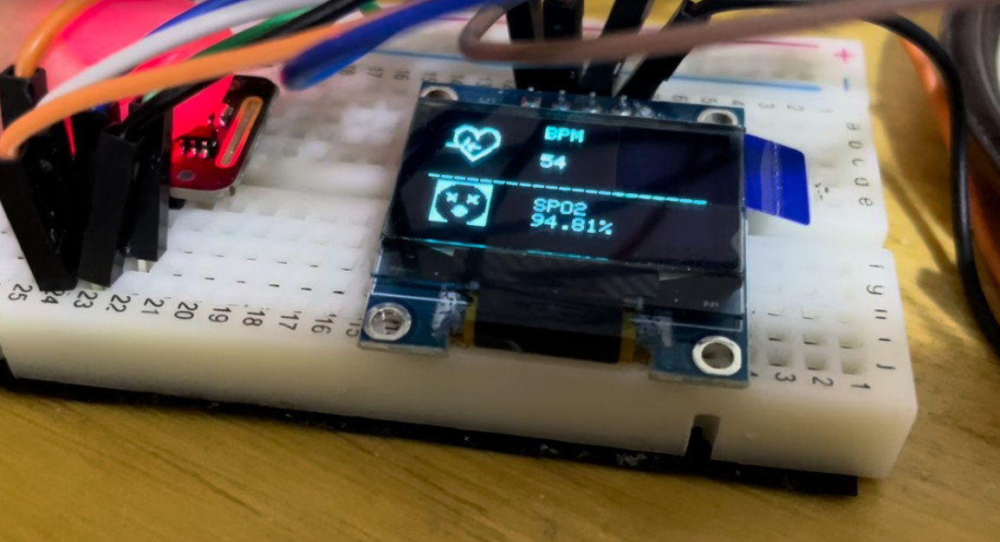

# ESP32 Pulse Oximeter

A low-cost pulse oximeter built on an ESP32 and a MAX30102 optical sensor. It measures heart rate and blood oxygen saturation (SpO₂) from the fingertip, shows both on an OLED display with an animated heartbeat and status icons, and beeps on every detected beat.

> **Context:** Student project, Biomedical Systems Engineering, Universidad Nacional Autónoma de México (UNAM), 2024.
>
> **Not a medical device.** This is an educational prototype. It has not been calibrated against a reference oximeter and must not be used for clinical decisions.



*Working prototype on a breadboard. The display shows heart rate and SpO₂ with their status icons; the MAX30102 sensor (left) is lit while reading a fingertip.*

---

## Features

- **Heart rate** from beat-to-beat intervals, averaged over the last 10 beats
- **SpO₂** estimated with the ratio-of-ratios method on red and infrared PPG signals
- **Finger detection**: prompts the user to place a finger when no signal is present
- **OLED interface** (128 × 64): live BPM and SpO₂ values, a heart icon that pulses with each beat, and status icons that classify the readings
- **Audible beat indicator**: a short beep from a buzzer on every detected heartbeat
- **Serial output** of the raw IR signal, for plotting the PPG waveform in the Arduino Serial Plotter

## Hardware

| Component | Details |
|---|---|
| Microcontroller | ESP32 development board (generic ESP32 DevKit) |
| Optical sensor | MAX30102 pulse oximetry and heart-rate sensor (MH-ET LIVE breakout board) |
| Display | SSD1306 OLED, 128 × 64 px, I²C (address `0x3C`) |
| Buzzer | Piezo buzzer (pin 3, as defined in the code) |
| Other | Breadboard and jumper wires |

### Wiring

The sensor and the display share the ESP32's I²C bus, using the default `Wire` pins.

| Module pin | ESP32 pin |
|---|---|
| MAX30102 VIN, OLED VCC | 3.3 V |
| MAX30102 GND, OLED GND | GND |
| MAX30102 SDA, OLED SDA | GPIO 21 (default SDA) |
| MAX30102 SCL, OLED SCL | GPIO 22 (default SCL) |
| Buzzer + | GPIO 3 (see Known limitations) |
| Buzzer − | GND |

## How it works

### 1. Signal acquisition
The MAX30102 shines red and infrared light into the fingertip and measures how much is absorbed. Each heartbeat changes the blood volume in the finger, which produces a photoplethysmography (PPG) waveform. The sensor is configured as:

| Parameter | Value |
|---|---|
| LED mode | Red + IR |
| Sample rate | 200 samples/s, averaged in groups of 4 |
| Pulse width | 411 µs (18-bit resolution) |
| ADC range | 16384 nA |
| I²C speed | 400 kHz |

### 2. Heart rate
- If the IR reading is below 7000, no finger is detected and the screen shows a prompt.
- Beats are detected on the IR signal with SparkFun's `checkForBeat()` peak-detection algorithm.
- The interval between consecutive beats gives the instantaneous rate: `BPM = 60 / Δt`.
- Values outside 20–255 BPM are rejected; the rest go into a 10-beat moving average.

### 3. SpO₂ (`spo2.hpp`)
SpO₂ uses the **ratio-of-ratios** method:

1. The DC level of each channel (red, IR) is tracked with an exponential low-pass filter (α = 0.95).
2. The AC component is accumulated as a root-mean-square value over windows of 100 samples.
3. The ratio is computed as

   `R = (AC_red / DC_red) / (AC_IR / DC_IR)`

4. R is converted to SpO₂ with a linear empirical calibration:

   `SpO₂ = −23.3 · (R − 0.4) + 100`

5. The estimate is smoothed with a second low-pass filter (factor 0.7).

### 4. Display and alerts
The screen classifies each reading with an icon:

| SpO₂ | Icon | | Heart rate | Icon |
|---|---|---|---|---|
| > 100 % | Out of range | | < 60 BPM | Low (bradycardia) |
| 95–100 % | Normal | | 60–100 BPM | Normal |
| 90–95 % | Mildly low | | > 100 BPM | High (tachycardia) |
| 75–90 % | Low | | | |
| < 75 % | Critical | | | |

## Getting started

1. Install the [Arduino IDE](https://www.arduino.cc/en/software) and the **ESP32 board package** (Boards Manager → *esp32* by Espressif).
2. Install these libraries from the Library Manager:
   - **SparkFun MAX3010x Pulse and Proximity Sensor Library** (`MAX30105.h`, `heartRate.h`)
   - **Adafruit SSD1306**
   - **Adafruit GFX Library**
3. Open `firmware/esp32_pulse_oximeter/esp32_pulse_oximeter.ino`, select your ESP32 board and port, and upload.
4. Open the Serial Monitor or Serial Plotter at **115200 baud** to see the raw IR signal.

## Repository structure

```
esp32-pulse-oximeter/
├── firmware/
│   └── esp32_pulse_oximeter/
│       ├── esp32_pulse_oximeter.ino   # main sketch: acquisition, heart rate, display, buzzer
│       └── spo2.hpp                   # SpO2 estimation (ratio of ratios)
├── docs/
│   └── images/                        # photos and screenshots
├── LICENSE
└── README.md
```

## Known limitations

This is the original student version of the project, kept as built. Known issues:

- **Heart-rate offset.** The displayed BPM adds a fixed offset (`cr = 50`) to the measured average, introduced during development. A likely root cause of the underlying underestimation is that the display is redrawn on every loop iteration, which slows sampling and causes missed beats; a fixed offset is not a valid calibration.
- **Buzzer pin.** On most ESP32 boards GPIO 3 is the UART RX pin used by `Serial`, so the buzzer should be moved to a free GPIO.
- **No calibration.** The SpO₂ equation is a generic empirical calibration, not fitted to this hardware or validated against a reference oximeter.
- **Threshold edge cases.** SpO₂ values of exactly 90, 95 or 100 % fall into the "critical" icon branch because the comparisons are strict.
- **Start-up behavior.** The SpO₂ estimate starts at 0 and needs several windows to converge, so the first readings show low values.
- **Unused code.** An arrhythmia alert is commented out, and some plotting and temperature variables in `spo2.hpp` are computed but not used.

### Possible improvements
- Sample the sensor at a fixed rate (or in a separate task) and update the display less often, removing the need for an offset
- Calibrate SpO₂ against a commercial pulse oximeter
- Add motion-artifact rejection and signal-quality checks
- Send readings to a phone or dashboard over the ESP32's Wi-Fi or Bluetooth

## Credits

- SpO₂ algorithm adapted from [coniferconifer/ESP32_MAX30102_simple-SpO2_plotter](https://github.com/coniferconifer/ESP32_MAX30102_simple-SpO2_plotter) (Apache License 2.0).
- Heart-beat detection uses the [SparkFun MAX3010x library](https://github.com/sparkfun/SparkFun_MAX3010x_Sensor_Library).
- Display handled with the Adafruit SSD1306 and GFX libraries.

## Author

**Ignacio Romero Fragoso**, Biomedical Systems Engineer, UNAM

## License

Licensed under the [Apache License 2.0](LICENSE).
